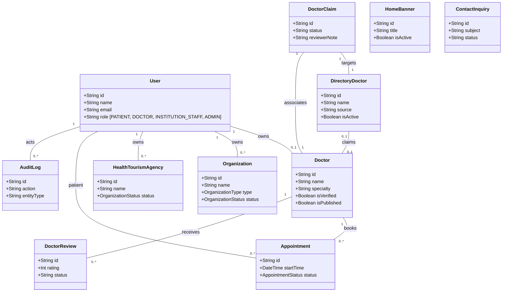
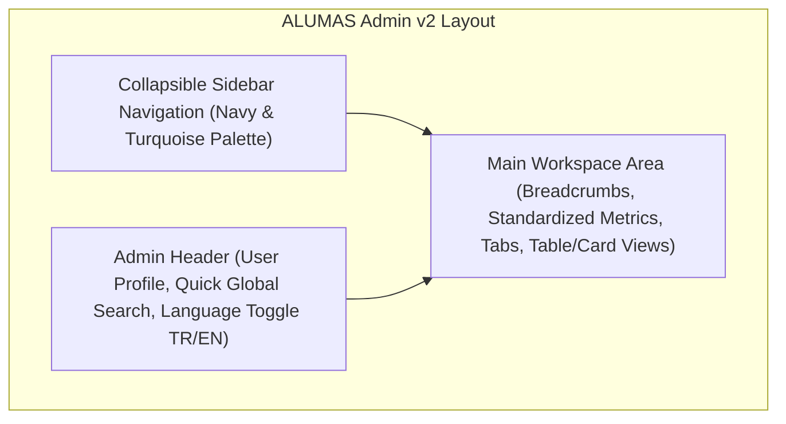
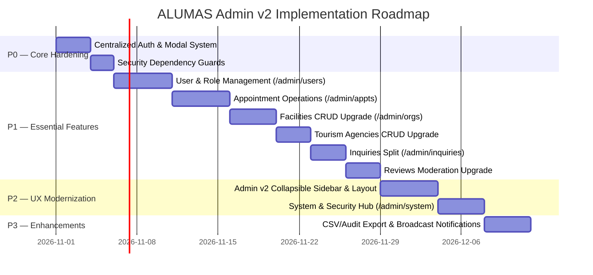

# ALUMAS — Admin Panel v2: Complete Architecture, Functionality & UX Audit

> **Document Status**: Complete Architecture & UX Audit  
> **Date**: October 24, 2026  
> **Target Audience**: Engineering Leadership, Product Management, UI/UX Design  
> **Scope**: Complete administrative surface across routing, backend APIs, Prisma models, security, and interface design.  
> **Directive**: **PHASE 1 IS AUDIT AND PLANNING ONLY.** Zero destructive changes, migrations, or file deletions.

---

## Executive Summary

Following the recent successful upgrade of the **Professionals Administration Module** (complete with CRUD, external directory integration, and audited claim revocation), this audit evaluates the entire remaining administration architecture of the ALUMAS platform.

The audit identifies:
1. **Critical Functionality Gaps**: Complete absence of dedicated admin interfaces for **User & Role Management** (only 10 read-only users shown) and **Appointment Operations** (only a numeric counter displayed).
2. **Structural Information Misplacement**: The `/admin/content` page (labeled simply "Banners" in navigation) crams together **Marketing Banners**, **Taxonomy Categories**, and **Customer Support Contact Inquiries** without resolution workflows.
3. **Incomplete Management CRUD**: `/admin/organizations`, `/admin/agencies`, and `/admin/reviews` lack search, multi-criteria filtering, pagination, and edit modals, rendering them difficult to operate at scale.
4. **DevOps/Admin Confusion**: `/admin/release` occupies a primary top-level navigation slot despite displaying read-only build metadata and immutable environment flags.
5. **UX & Design Fragmentation**: Heavy reliance on native browser `prompt()` and `confirm()` dialogs, missing container styles for `.workspace-nav`, horizontal tab bar overflow on tablet/mobile screens, and lack of visual alignment with ALUMAS’s premium Navy/Turquoise design system.

The proposed **Admin v2 Architecture** reorganizes the administration panel into **4 task-oriented hubs**:
- **Overview (Genel Bakış)**: Executive KPIs, operational pulse, and pending action queues.
- **Network & Directory (Sağlık Ağı & Dizin)**: Professionals, Facilities, and Tourism Agencies.
- **Operations & Moderation (Operasyon & Moderasyon)**: Users, Appointments, Reviews, Support Inquiries, and Content.
- **System & Security (Sistem & Güvenlik)**: Audit Logs, Release Status, Feature Flags, and Platform Health.

---

## 1. Complete Existing Admin Architecture Inventory

### 1.1 Existing Routes & Navigation

| Route | Title / Breadcrumb | Navigation Source | Backend Route Handler / Controller | Client Component | Access Guard |
| :--- | :--- | :--- | :--- | :--- | :--- |
| `/admin` | Alumas Admin / Genel Bakış | Primary Nav (1st tab) | Server Page DB Queries (`prisma.user.count()`, `doctor.count()`, `appointment.count()`, `findMany(take: 10)`) | Inline Page + `components/audit-log-viewer.tsx` | Layout: `role === "ADMIN"`<br>Page: `role === "ADMIN"` |
| `/admin/organizations` | Kurum başvuruları | Primary Nav (2nd tab) | `/api/admin/organizations`<br>`/api/admin/organizations/[id]` | `components/admin-organizations.tsx` | Layout: `role === "ADMIN"`<br>Page: `role === "ADMIN"` |
| `/admin/doctors` | Uzman başvuruları | Primary Nav (3rd tab) | `/api/admin/doctors`<br>`/api/admin/doctors/[id]`<br>`/api/admin/doctors/directory`<br>`/api/admin/doctors/directory/[id]`<br>`/api/admin/doctors/claims`<br>`/api/admin/doctors/claims/[id]` | `components/admin-doctor-list.tsx` | Layout: `role === "ADMIN"`<br>Page: `role === "ADMIN"` |
| `/admin/agencies` | Sağlık Turizmi Acenteleri | Primary Nav (4th tab) | `/api/admin/agencies` | `components/admin-agency-list.tsx` | Layout: `role === "ADMIN"`<br>Page: `role === "ADMIN"` |
| `/admin/content` | Banners & Content | Primary Nav (5th tab, labeled "Banner") | `/api/admin/content` | `components/content-admin-client.tsx` | Layout: `role === "ADMIN"`<br>Page: `role === "ADMIN"` |
| `/admin/reviews` | Yorum Moderasyonu | Primary Nav (6th tab) | `/api/admin/reviews` | `components/admin-review-moderation.tsx` | Layout: `role === "ADMIN"`<br>Page: `role === "ADMIN"` |
| `/admin/release` | Sistem ve Sürüm Durumu | Primary Nav (7th tab) | `/api/admin/release-status` | `components/release-dashboard-client.tsx` | Layout: `role === "ADMIN"`<br>Page: `role === "ADMIN"` |

---

### 1.2 Admin API Endpoints & Server Capabilities

```mermaid
graph LR
    subgraph Admin_APIs["app/api/admin/"]
      ops["/api/admin/ops (GET)"]
      audit["/api/admin/audit (GET)"]
      rel["/api/admin/release-status (GET)"]
      doc["/api/admin/doctors (GET, PATCH)"]
      docId["/api/admin/doctors/[id] (GET, PATCH, DELETE)"]
      docDir["/api/admin/doctors/directory (GET)"]
      docDirId["/api/admin/doctors/directory/[id] (GET, PATCH)"]
      claims["/api/admin/doctors/claims (GET)"]
      claimsId["/api/admin/doctors/claims/[id] (PATCH)"]
      org["/api/admin/organizations (GET)"]
      orgId["/api/admin/organizations/[id] (PATCH, DELETE)"]
      orgFile["/api/admin/organizations/[id]/file (GET)"]
      agency["/api/admin/agencies (GET, PATCH, DELETE)"]
      content["/api/admin/content (GET, POST, PATCH, DELETE)"]
      rev["/api/admin/reviews (GET, PATCH)"]
      verDocs["/api/admin/verification-documents/[id] (PATCH)"]
    end
```



Detailed Endpoint Analysis:
1. **`/api/admin/ops` (GET)**:
   - Returns 24-hour metric aggregations: `audit24`, `failedAudit24`, `failedLogins24`, `newAppointments24`, `newUsers24`, and process memory/uptime snapshot.
   - Guarded: Server-side check `u.role === "ADMIN"`.
2. **`/api/admin/audit` (GET)**:
   - Queries `prisma.auditLog` with filters for `action`, `outcome`, `entityType`, and ISO date range (`from`, `to`). Returns up to 500 records.
   - Guarded: Server-side check `u.role === "ADMIN"`.
3. **`/api/admin/doctors` (GET, PATCH)**:
   - `GET`: Returns registered specialists with user and document relations. Supports query params `q`, `status`, `published`.
   - `PATCH`: Toggles `isVerified` and `isPublished` with required document verification check.
4. **`/api/admin/doctors/[id]` (GET, PATCH, DELETE)**:
   - `GET`: Rich details card including relation counts (`appointments`, `carePlans`, `reviews`).
   - `PATCH`: Updates administrative fields (`title`, `specialty`, `city`, `hospital`, `licenseNumber`, `price`, `bio`, `isPublished`). Audited as `doctor.profile.updated`.
   - `DELETE`: Enforces **Clinical Dependency Guard**. Rejects hard deletion if patient dependencies exist; permits safe disposal of zero-dependency test records. Audited as `doctor.profile.deleted`.
5. **`/api/admin/doctors/directory` (GET)**:
   - Paginated endpoint for 386 external directory specialists with search `q`, `specialty`, `city`, `source`, `claimStatus`, `active` filters, and aggregated summary stats.
6. **`/api/admin/doctors/directory/[id]` (GET, PATCH)**:
   - Updates directory doctor metadata and active listing toggle with mandatory audit reason (`directory_doctor.updated`).
7. **`/api/admin/doctors/claims` (GET)**:
   - Returns claim requests with applicant profile, target specialist, and structured identity match calculations (`SURNAME_MISMATCH`, `GIVEN_NAME_MISMATCH`, etc.).
8. **`/api/admin/doctors/claims/[id]` (PATCH)**:
   - Handles `APPROVED` (with override verification), `REJECTED`, and `REVOKED` (detaches profile, reverts user role, unpublishes listing, and records `doctor.claim.revoked`).
9. **`/api/admin/organizations` (GET)**:
   - Returns institutions with owner and document relations; checks `AuditLog` and `OrganizationClaim` for claim provenance.
10. **`/api/admin/organizations/[id]` (PATCH, DELETE)**:
    - `PATCH`: Handles `APPROVED`, `REJECTED`, `SUSPENDED`, `PENDING`. Validates document credentials, city-name duplicates, and unlinks directory institution when rejected.
    - `DELETE`: Enforces dependency check (`doctors`, `services`, `reviews`, `appointments`).
11. **`/api/admin/organizations/[id]/file` (GET)**:
    - Streams legacy license file from filesystem.
12. **`/api/admin/agencies` (GET, PATCH, DELETE)**:
    - `GET`: Lists health tourism agencies with package count (`_count: { packages: true }`).
    - `PATCH`: Toggles `status: "APPROVED" | "REJECTED"`, verifies accreditation documents, synchronizes packages.
    - `DELETE`: Enforces package dependency check (`_count.packages > 0` blocks deletion).
13. **`/api/admin/content` (GET, POST, PATCH, DELETE)**:
    - Multi-entity controller: handles `banner`, `category`, and `inquiry`.
    - `POST`: Creates banners and categories.
    - `PATCH`: Toggles active status on banners/categories; closes inquiries.
    - `DELETE`: Deletes banners and categories with audit logs.
14. **`/api/admin/reviews` (GET, PATCH)**:
    - `GET`: Returns doctor and organization reviews; supports `status` filter (`PENDING`, `APPROVED`, `REJECTED`, `ALL`).
    - `PATCH`: Approves or rejects review, updates aggregate doctor rating, records `review.approved` or `review.rejected`.
15. **`/api/admin/verification-documents/[id]` (PATCH)**:
    - Approves or rejects individual verification documents (`IDENTITY`, `MEDICAL_LICENSE`, `SPECIALTY_CERTIFICATE`, `FACILITY_LICENSE`, etc.) with reviewer notes.

---

### 1.3 Prisma Models & Administrative Coverage



**Coverage Status**:
- **Fully Covered in Admin UI**: `Doctor`, `DirectoryDoctor`, `DoctorClaim`, `VerificationDocument`.
- **Partially Covered**: `Organization`, `HealthTourismAgency`, `HomeBanner`, `ContentCategory`, `DoctorReview`, `OrganizationReview`, `AuditLog`.
- **Severely Under-Covered (Missing UI)**:
  - `User`: Only 10 read-only items on dashboard. No user detail, role management, or account search.
  - `Appointment`: Only an aggregate count displayed. No appointment list, no doctor/patient inspection, no dispute or cancellation view.
  - `ContactInquiry`: Displayed as a static list on the Banners page without reply or resolution actions.
  - `HealthTourismPackage`: Packages count shown, but package content and pricing cannot be inspected.
  - `InsuranceProvider` & `EmergencyProvider`: Completely missing from admin interface.

---

## 2. Admin Feature & CRUD Capability Matrix

| Administrative Entity | Module / Route | Create | Read / Detail | Update / Edit | Delete / Deactivate | Restore / Reactivate | Search & Filters | Pagination | Approval Workflow | Audit Trail | UI Completeness Score |
| :--- | :--- | :---: | :---: | :---: | :---: | :---: | :---: | :---: | :---: | :---: | :---: |
| **Registered Specialists** | `/admin/doctors`<br>`Tab 1: Kayıtlı Uzmanlar` | Via Onboarding | **Full** (Detail modal) | **Full** (Edit modal) | **Guarded** (Safe delete if 0 deps) | **Full** (Publish toggle) | **Full** (Name, city, specialty, license) | Local | **Full** (Document check) | **Full** (`doctor.*`) | **95%** (Gold Standard) |
| **Directory Specialists** | `/admin/doctors`<br>`Tab 2: Dizin Uzmanları` | Via Seed Pipelines | **Full** (Row card) | **Full** (Edit modal) | **Full** (Hide listing) | **Full** (Restore listing) | **Full** (Search, specialty, source, claim) | **Full** (Server 20/page) | N/A (External Registry) | **Full** (`directory_doctor.*`) | **95%** (Gold Standard) |
| **Doctor Claims** | `/admin/doctors`<br>`Tab 3: Sahiplenme Talepleri` | Via Claim Portal | **Full** (Match analysis) | **Full** (Reviewer notes) | N/A | Re-claimable | Filter by Status | Local | **Full** (Override guard) | **Full** (`doctor.claim.*`) | **95%** (Gold Standard) |
| **Healthcare Facilities** | `/admin/organizations` | Via Business Portal | **Partial** (Row only, no modal) | **Incomplete** (No edit modal) | **Guarded** (API only, missing in UI) | **Full** (Suspend & Reapprove) | **None** (Missing search & filters in UI) | **None** (Renders all) | **Full** (Credential block) | **Full** (`organization.*`) | **55%** (Requires P1 Upgrade) |
| **Tourism Agencies** | `/admin/agencies` | Via Agency Portal | **Basic** (Name & owner only) | **None** (No edit modal) | **Guarded** (API only, missing in UI) | **Full** (Suspend toggle) | **None** (No search in UI) | **None** | **Full** (Accreditation doc) | **Full** (`agency.*`) | **50%** (Requires P1 Upgrade) |
| **Users & Accounts** | `/admin` (Overview) | Via Register | **Extremely Limited** (10 recent users) | **None** (Cannot edit role/info) | **None** (Cannot suspend/ban) | **None** | **None** | **None** | N/A | Login attempt log | **15%** (Severe P1 Gap) |
| **Appointments** | None (Dashboard counter only) | Via Patient Booking | **None** (Only count: 20) | **None** | **None** (Cannot cancel/refund) | **None** | **None** | **None** | N/A | Booked log | **5%** (Severe P1 Gap) |
| **Marketing Banners** | `/admin/content`<br>`Section 1` | **Full** (Form) | **Basic** (Title & subtitle) | **Incomplete** (Toggle only, no edit) | **API Only** (Missing button in UI) | **Full** (Toggle active) | **None** | **None** | N/A | **Full** (`content.banner.*`) | **60%** (Requires P1 Upgrade) |
| **Content Categories** | `/admin/content`<br>`Section 2` | **Full** (Form) | **Basic** (Name & template) | **Incomplete** (Toggle only, no edit) | **API Only** (Missing button in UI) | **Full** (Toggle active) | **None** | **None** | N/A | **Full** (`content.category.*`) | **60%** (Requires P1 Upgrade) |
| **Contact Inquiries** | `/admin/content`<br>`Section 3` | Via Public Contact | **Basic** (Message text) | **None** (Cannot close/reply) | **None** | **None** | **None** | **None** | N/A | **Full** (`content.inquiry.*`) | **30%** (Misplaced, Needs Split) |
| **Reviews Moderation** | `/admin/reviews` | Via Patient Review | **Basic** (Pending only) | **Incomplete** (Approve/Reject only) | **None** | **None** (No undo) | **None** | **None** | **Full** (Rating update) | **Full** (`review.*`) | **50%** (Requires P1 Upgrade) |
| **Audit Logs** | `/admin` (Overview footer) | System Generated | **Good** (Action, entity, outcome) | N/A (Immutable) | N/A (Prohibited) | N/A (Prohibited) | **Basic** (Action, outcome) | **Partial** (Slice 100) | N/A | Native | **65%** (Move to System Hub) |
| **Release & Ops Status** | `/admin/release` | System Config | **Good** (SHA, flags, DB ping) | N/A | N/A | N/A | N/A | N/A | N/A | None | **50%** (Move to System Hub) |

---

## 3. Redundancy, Structural Deficiencies & Architectural Problems

### 3.1 Detailed Code Evidence & Categorization

#### Finding 1: The "Banners" Page Architecture Violation (Misplaced Customer Support)
- **File**: [`app/admin/content/page.tsx`](file:///c:/active_projects/alumas/alumas.com/app/admin/content/page.tsx) and [`components/content-admin-client.tsx`](file:///c:/active_projects/alumas/alumas.com/components/content-admin-client.tsx#L115-L129)
- **Code Evidence**:
  Lines 115-129 of `content-admin-client.tsx` render incoming patient/business contact inquiries directly under marketing banners and content categories:
  ```tsx
  <section className="panel">
    <h2>{t("inquiriesSectionTitle")}</h2>
    <div className="slot-list">
      {d.inquiries.map((x: any) => (
        <div className="slot-row" key={x.id}>
          <div>
            <b>{x.subject}</b>
            <span>{x.name} · {x.email} · {x.message}</span>
          </div>
          <span className="status">{x.status}</span>
        </div>
      ))}
    </div>
  </section>
  ```
- **Issue**:
  - The navigation item says "Banner", so staff looking for customer inquiries will never look there.
  - Inquiries are completely read-only in the UI. Although `/api/admin/content` accepts `PATCH` with `status: "closed"`, there is no button or resolution action in the interface!
- **Classification**: **MERGE & SPLIT (P1)**
  - Retain Banners & Categories under `Marketing & Content` (`/admin/content`).
  - Extract Inquiries into a dedicated `Support & Inquiries` module (`/admin/inquiries`) with status actions (Açık / İnceleniyor / Çözüldü).

---

#### Finding 2: Missing Core Management Modules (Users & Appointments)
- **Code Evidence**:
  In [`app/admin/page.tsx`](file:///c:/active_projects/alumas/alumas.com/app/admin/page.tsx#L28-L58):
  ```tsx
  <div className="metric">
    <span>{t("users")}</span>
    <strong>{users}</strong>
    <small>{t("totalAccounts")}</small>
  </div>
  ...
  <section className="panel">
    <h2>{t("recentUsers")}</h2>
    <div className="slot-list">
      {recent.map(x => (
        <div className="slot-row" key={x.id}>
          <div><b>{x.name}</b><span>{x.email}</span></div>
          <span className="status">{x.role}</span>
        </div>
      ))}
    </div>
  </section>
  ```
- **Issue**:
  - There is zero ability to search for a user by email, name, or phone.
  - Admins cannot inspect user details, view owned pharmacies/doctors/agencies, or manage roles (`PATIENT`, `DOCTOR`, `INSTITUTION_STAFF`, `ADMIN`).
  - Appointments are shown only as a numeric count (`prisma.appointment.count()`). There is no appointments list, calendar view, or booking resolution interface anywhere in `/admin`.
- **Classification**: **IMPROVE (P1 — High Value Essential Additions)**
  - Implement `/admin/users`: User search, role management, account status, owned entity mapping.
  - Implement `/admin/appointments`: Central operational booking monitor, status filters (Confirmed, Pending, Cancelled, Completed), doctor/patient details, and video consultation link inspection.

---

#### Finding 3: Facilities & Agencies Missing Enterprise Search, Filtering, and Modals
- **Files**: [`components/admin-organizations.tsx`](file:///c:/active_projects/alumas/alumas.com/components/admin-organizations.tsx#L50-L70) and [`components/admin-agency-list.tsx`](file:///c:/active_projects/alumas/alumas.com/components/admin-agency-list.tsx#L10-L20)
- **Code Evidence**:
  In `admin-organizations.tsx`:
  ```tsx
  async function load() {
    const response = await fetch("/api/admin/organizations");
    const data = await response.json();
    setRows(data);
  }
  ```
  In `admin-agency-list.tsx`:
  ```tsx
  async function load() {
    const response = await fetch("/api/admin/agencies");
    const data = await response.json();
    setRows(data);
  }
  ```
- **Issue**:
  - Neither component passes query parameters. No search bar exists. No filtering by city, organization type, or approval status exists in the UI.
  - No pagination: all records are rendered in a continuous DOM tree.
  - No edit modal exists to update administrative fields (address, phone, contact email, website) without running manual database scripts.
  - In `admin-agency-list.tsx`, package count (`_count: { packages: true }`) is returned by the API but completely ignored by the UI.
- **Classification**: **IMPROVE (P1)**
  - Elevate both components to match the gold standard pattern established in `components/admin-doctor-list.tsx` (search bar, filter dropdowns, edit modal, detail card, guarded delete).

---

#### Finding 4: Review Moderation "Disappearing Records" & Native Browser Prompts
- **File**: [`components/admin-review-moderation.tsx`](file:///c:/active_projects/alumas/alumas.com/components/admin-review-moderation.tsx#L11-L28)
- **Code Evidence**:
  ```tsx
  async function load() {
    const r = await fetch('/api/admin/reviews');
    if (r.ok) setData(await r.json());
  }
  async function act(kind: string, id: string, status: string) {
    const reason = status === 'REJECTED' ? prompt(t('promptReason')) || '' : '';
    ...
  }
  ```
- **Issue**:
  - The API defaults to `where: { status: "PENDING" }`. As soon as an admin clicks "Approve" or "Reject", the review vanishes from the screen.
  - Admins cannot review historical approved or rejected reviews, cannot search by reviewer or target specialist, and cannot reverse an accidental rejection or approval.
  - Uses native browser `prompt()`, which blocks thread execution and looks unpolished.
- **Classification**: **IMPROVE (P1)**
  - Implement tabs: `Bekleyenler (Pending)`, `Onaylananlar (Approved)`, `Reddedilenler (Rejected)`, and `Tümü (All)`.
  - Replace `prompt()` with an accessible custom modal.

---

#### Finding 5: Release Dashboard Occupying Primary Navigation
- **File**: [`app/admin/release/page.tsx`](file:///c:/active_projects/alumas/alumas.com/app/admin/release/page.tsx) and [`components/release-dashboard-client.tsx`](file:///c:/active_projects/alumas/alumas.com/components/release-dashboard-client.tsx)
- **Code Evidence**:
  In `components/admin-nav.tsx`:
  ```tsx
  { href: "/admin/release", label: t("release") }
  ```
- **Issue**:
  - `/admin/release` shows read-only git commit SHA, package version, release channel, DB ping, and environment variables.
  - It contains zero operational business actions for daily administrators.
  - It clutters the primary navigation bar alongside high-frequency entities.
- **Classification**: **MERGE (P2)**
  - Merge `/admin/release` and `/components/audit-log-viewer.tsx` into a unified **Sistem & Güvenlik (System & Security)** section (`/admin/system`).

---

### 3.2 Action Classification Table

| Page / Component | Current Location | Proposed Action | Rationalized Target Architecture |
| :--- | :--- | :---: | :--- |
| **Doctors Management** | `/admin/doctors` | **KEEP (Benchmark)** | Remains primary module under **Sağlık Ağı & Dizin**. Serves as model for other modules. |
| **Overview Dashboard** | `/admin` | **IMPROVE** | Elevate to Executive Platform Overview (KPI metrics, urgent action queues, quick links). |
| **Organizations Management** | `/admin/organizations` | **IMPROVE** | Upgrade to full CRUD with search, type/city/status filtering, detail modal, edit modal, guarded delete. |
| **Health Tourism Agencies** | `/admin/agencies` | **IMPROVE** | Upgrade with search toolbar, package inspection modal, edit modal, and guarded delete. |
| **Content Banners & Categories** | `/admin/content` | **IMPROVE** | Focus exclusively on Marketing Banners & Content Categories with full CRUD (edit modals, delete). |
| **Customer Contact Inquiries** | Buried in `/admin/content` | **MERGE & SPLIT** | Move to dedicated `/admin/inquiries` with response status tracking and resolution notes. |
| **Review Moderation** | `/admin/reviews` | **IMPROVE** | Add status tabs (`Pending`, `Approved`, `Rejected`), search, undo/re-moderation capability. |
| **Release Status** | `/admin/release` | **MERGE** | Move out of top-level nav; merge with Audit Logs into `/admin/system` (Sistem & Güvenlik). |
| **Audit Log Viewer** | Embedded in `/admin` footer | **MERGE** | Move to full-page dedicated subtab under `/admin/system` with advanced filters and metadata viewer. |
| **User & Account Management** | None | **NEW (P1)** | Implement `/admin/users` for searching users, managing roles, and inspecting account details. |
| **Appointments Operations** | None | **NEW (P1)** | Implement `/admin/appointments` for searching, filtering, and inspecting clinical consultations. |

---

## 4. Overall Admin UX Quality & Design Direction

### 4.1 Current UX Friction Points

```
[Current Navigation: Horizontal Wrapped Pills]
[ Genel Bakış ] [ Kurumlar ] [ Uzmanlar ] [ Acenteler ] [ Banner ] [ Yorumlar ] [ Release ]
  ↳ Horizontal crowding on smaller screens
  ↳ Flat hierarchy mixes DevOps checks (Release) with Business Entities (Doctors)
  ↳ Missing critical daily tasks (Users, Appointments, Inquiries)
  ↳ Inconsistent modal patterns (some custom, some native browser prompt())
```

1. **Navigation Structure**:
   - `components/admin-nav.tsx` renders a single flex row of pills. On viewport widths between 768px and 1100px, the pills wrap into two uneven rows.
   - There are no breadcrumbs or section indicators.
2. **Modal Experience**:
   - `/admin/doctors` uses polished React modals with backdrops and form validation.
   - `/admin/organizations` and `/admin/reviews` use blocking browser `prompt()` dialogs, creating a jarring, inconsistent experience.
3. **Table & Card Density**:
   - Cards in `components/admin-organizations.tsx` are vertically tall (~250px per item) with no compact table alternative, making scrolling tedious when reviewing dozens of facilities.
4. **Responsive Layouts**:
   - Forms on `/admin/content` use fixed flex pairs that break on narrow mobile viewports.
5. **Color & Brand Consistency**:
   - The public application uses ALUMAS’s Navy/Turquoise palette (`#0f172a`, `#0ea5e9`, `#2563eb`).
   - The admin panel uses various ad-hoc CSS variables (`var(--line)`, `var(--border-light)`, `var(--bg)`), resulting in minor visual discrepancies between pages.

---

### 4.2 Recommended Admin v2 Design Direction



1. **Collapsible Admin Sidebar Navigation**:
   - Grouped into 4 clear collapsible sections:
     - 📊 **Genel Bakış (Overview)**
     - 🏥 **Sağlık Ağı & Dizin (Network & Directory)**
     - ⚡ **Operasyon & Moderasyon (Operations & Moderation)**
     - 🛡️ **Sistem & Güvenlik (System & Security)**
   - Fully responsive: collapses to an icon rail on tablet, drawer on mobile.
2. **Standardized Reusable Management Layout**:
   - Uniform page header with kicker, title, summary subtitle, and primary action button.
   - Universal **Search & Filter Toolbar** across every table/card view.
   - Reusable **Data Table / Card Grid** with built-in empty states, loading skeletons, and pagination controls.
3. **Zero Native Browser Prompts**:
   - All approvals, rejections, revocations, and deletions utilize unified accessible modal dialogs with structured validation and reason capture.
4. **Visual Language Alignment**:
   - Deep Slate/Navy headers (`#0f172a`), crisp white surfaces (`#ffffff`), subtle borders (`#e2e8f0`), and vibrant Turquoise/Indigo accents (`#0ea5e9`, `#2563eb`).
   - Standardized status badges:
     - Verified / Approved: Light Emerald background (`#dcfce7`), text (`#15803d`).
     - Pending / In Review: Light Amber background (`#fef3c7`), text (`#b45309`).
     - Rejected / Suspended: Light Rose background (`#fee2e2`), text (`#b91c1c`).
     - Inactive / Hidden: Slate background (`#f1f5f9`), text (`#64748b`).

---

## 5. Security & Data Integrity Audit

### 5.1 Authorization & Middleware Invariants
1. **Layout-Level Protection**:
   - [`app/admin/layout.tsx`](file:///c:/active_projects/alumas/alumas.com/app/admin/layout.tsx#L6-L8) executes server-side validation:
     ```ts
     const u = await currentUser();
     if (!u) redirect('/login');
     if (u.role !== "ADMIN") redirect('/profile');
     ```
   - All subroutes under `/admin/*` automatically inherit this layout gate.
2. **API Endpoint Route Handlers**:
   - Every route in `app/api/admin/*` enforces server-side `currentUser()` role checks. Non-admin and unauthenticated requests consistently return HTTP 403 Forbidden.
   - **Finding**: In public routes with admin overrides (such as `/api/organizations/[id]/services`), admin access relies on `currentUser()?.role === "ADMIN"`. Because sessions are verified in the database via `tokenHash`, there is no risk of client-side role spoofing.
3. **Disposal Invariants**:
   - Destructive operations strictly require foreign-key dependency verification. Deleting active clinical doctors, facilities with doctors/services, or agencies with packages is blocked with structured error codes (`HAS_DEPENDENCIES`).

### 5.2 Areas for Security Hardening in Admin v2
1. **Centralized Admin Authorization Helper**:
   - Currently, each admin route defines its own inline helper (e.g. `async function adminUser()`, `async function ok()`, `async function requireAdmin()`).
   - **Recommendation**: Standardize on a single, exported helper `requireAdminUser(req)` in `@/lib/auth-admin.ts` returning `{ user, errorResponse }`.
2. **Category Deletion Dependency Check**:
   - `DELETE /api/admin/content?kind=category&id=...` deletes a `ContentCategory`. Although categories are primarily taxonomy, any future relation to active services should be checked before deletion.
3. **Audit Trail Parity**:
   - User role changes (e.g. promoting a user to `ADMIN` or demoting a user to `PATIENT`) must record an audit entry with `action: "user.role.updated"`.

---

## 6. Prioritized Implementation Roadmap (P0 / P1 / P2 / P3)



### P0 — Critical (Security & Core Architecture Hardening)
- **Task P0.1**: Create centralized `lib/admin-auth.ts` helper for consistent server-side authorization across all admin endpoints.
- **Task P0.2**: Eliminate all remaining browser `prompt()` and `confirm()` calls; standardize on accessible modal dialogs.
- **Task P0.3**: Add category deletion safety check to prevent removing taxonomy categories linked to active services.

### P1 — High Value (Missing Management Capabilities & Redundancy Merging)
- **Task P1.1 (User Management Module)**:
  - Create `/admin/users` and `/api/admin/users`: Search, filter by role (`PATIENT`, `DOCTOR`, `INSTITUTION_STAFF`, `ADMIN`), view user profile card, owned organizations, role update with audit log.
- **Task P1.2 (Appointment Operations Module)**:
  - Create `/admin/appointments` and `/api/admin/appointments`: Operational booking monitor with date range, doctor, patient, status filters (`CONFIRMED`, `PENDING`, `COMPLETED`, `CANCELLED`), and video room link inspection.
- **Task P1.3 (Facilities Management CRUD Upgrade)**:
  - Upgrade `components/admin-organizations.tsx`: Add search bar, city/type/status filter dropdowns, pagination, facility detail card, facility edit modal, and guarded delete button.
- **Task P1.4 (Tourism Agencies CRUD Upgrade)**:
  - Upgrade `components/admin-agency-list.tsx`: Add search bar, package count inspection modal, edit modal, and guarded delete button.
- **Task P1.5 (Customer Inquiries Extraction & Management)**:
  - Extract inquiries from `/admin/content` into `/admin/inquiries`: Status workflow (`OPEN`, `IN_PROGRESS`, `CLOSED`), resolution notes, and search.
- **Task P1.6 (Review Moderation Upgrade)**:
  - Upgrade `components/admin-review-moderation.tsx`: Add status tabs (`Pending`, `Approved`, `Rejected`, `All`), search, and un-publish / re-moderate actions.

### P2 — UX Modernization & Layout Redesign
- **Task P2.1 (Admin v2 Collapsible Sidebar)**:
  - Replace horizontal `.workspace-nav` with modern, responsive sidebar navigation supporting 4 categorized hubs (Overview, Network, Operations, System).
- **Task P2.2 (System & Security Hub)**:
  - Merge `/admin/release` and `/components/audit-log-viewer.tsx` into a unified `/admin/system` section with tabs for Audit Logs, System & Release Status, and Feature Flags.
- **Task P2.3 (Reusable Data Table Component)**:
  - Standardize search, filters, pagination, and bulk selection into a shared `@/components/admin/data-table.tsx`.

### P3 — Optional Enhancements (Future Sprints)
- **Task P3.1**: CSV / JSON export for directory doctors and audit logs.
- **Task P3.2**: System broadcast notification sender (`/admin/notifications`).
- **Task P3.3**: Insurance provider directory manager (`/admin/insurance`).

---

## 7. Recommended Admin v2 Information Architecture

```
ALUMAS ADMIN v2 SITEMAP
├── 1. GENEL BAKIŞ (OVERVIEW)
│   └── Dashboard (/admin)
│       ├── KPI Kartları (Kullanıcılar, Hekimler, Kurumlar, Randevular)
│       ├── Bekleyen İşlemler Kuyruğu (Onay bekleyen belgeler, sahiplenmeler, yorumlar)
│       └── Hızlı Eylemler & Kısayollar
│
├── 2. SAĞLIK AĞI & DİZİN (NETWORK & DIRECTORY)
│   ├── Uzmanlar (/admin/doctors)
│   │   ├── [Tab 1] Kayıtlı Uzmanlar (Registered Doctors - CRUD)
│   │   ├── [Tab 2] Dizin Uzmanları (External Directory - 386 hekim)
│   │   └── [Tab 3] Sahiplenme Talepleri (Claim Requests & Revocation)
│   ├── Sağlık Kurumları (/admin/organizations)
│   │   ├── [Tab 1] Kayıtlı Kurumlar (Active Facilities - CRUD)
│   │   ├── [Tab 2] Başvuru & Doğrulama (Pending Approvals)
│   │   └── [Tab 3] Dizin Kurumları (External Institution Registry)
│   └── Sağlık Turizmi (/admin/agencies)
│       ├── [Tab 1] Acenteler (Agencies list & verification)
│       └── [Tab 2] Paket & Hizmet İnceleme (Packages inspection)
│
├── 3. OPERASYON & MODERASYON (OPERATIONS & MODERATION)
│   ├── Kullanıcılar (/admin/users) [P1 NEW]
│   │   └── Arama, rol yönetimi, hesap detayları, sahip olduğu varlıklar
│   ├── Randevular (/admin/appointments) [P1 NEW]
│   │   └── Takvim/liste görünümü, durum filtreleri, doktor/hasta eşleşmesi
│   ├── Yorum Moderasyonu (/admin/reviews)
│   │   ├── [Tab 1] Bekleyenler (Pending)
│   │   ├── [Tab 2] Onaylananlar (Approved)
│   │   └── [Tab 3] Reddedilenler (Rejected)
│   ├── İletişim & Destek (/admin/inquiries) [P1 MERGED & SPLIT]
│   │   └── İletişim talepleri, durum yönetimi, yanıt notları
│   └── Pazarlama & İçerik (/admin/content)
│       ├── [Tab 1] Ana Sayfa Bannerları (Home Banners)
│       └── [Tab 2] Hizmet & İçerik Kategorileri (Content Categories)
│
└── 4. SİSTEM & GÜVENLİK (SYSTEM & SECURITY) [P2 MERGED HUB]
    └── Sistem & Güvenlik (/admin/system)
        ├── [Tab 1] Güvenlik & Audit Kayıtları (Full Audit Log Viewer)
        ├── [Tab 2] Sistem Sağlığı & Sürüm (Release Status & DB ping)
        └── [Tab 3] Özellik Bayrakları (Feature Flags)
```

---

## 8. Exact Implementation Order & Risk Management

| Phase | Milestone | Scope | Dependencies | Regression Risks & Mitigations |
| :---: | :--- | :--- | :--- | :--- |
| **Phase 2.1** | **Core Authorization & Modals** | Centralize admin auth helper (`lib/admin-auth.ts`); replace browser `prompt()` with modal components. | None | **Low risk**: Unit tests verify 403 on unauth/non-admin. |
| **Phase 2.2** | **Users & Role Management** | Build `/api/admin/users` and `/admin/users`. | Phase 2.1 | **Low risk**: Non-destructive, reads existing `User` model, audited role changes. |
| **Phase 2.3** | **Appointments Operations** | Build `/api/admin/appointments` and `/admin/appointments`. | Phase 2.1 | **Low risk**: Read-only first; status updates preserve clinical audit logs. |
| **Phase 2.4** | **Facilities CRUD Elevation** | Upgrade `components/admin-organizations.tsx` with search, filters, modals. | Phase 2.1 | **Low risk**: Existing approval backend intact; contract tests verify compatibility. |
| **Phase 2.5** | **Agencies & Inquiries Restructure** | Upgrade `admin-agency-list.tsx`; split inquiries into `/admin/inquiries`. | Phase 2.1 | **Low risk**: Inquiries route backward-compatible with `/api/admin/content`. |
| **Phase 2.6** | **Reviews Moderation Upgrade** | Add status tabs (`Pending`, `Approved`, `Rejected`), undo capability. | Phase 2.1 | **Low risk**: Backend API already supports `status` query parameter. |
| **Phase 2.7** | **Admin v2 Layout & Sidebar** | Implement collapsible sidebar, merge `/admin/release` into `/admin/system`. | Phases 2.1–2.6 | **Zero regression risk**: Existing routes remain accessible via URL redirects. |

---

## Conclusion & Readiness Verdict

The ALUMAS administrative system has strong foundations—particularly in the recently modernized **Professionals Module**, which sets a high benchmark for secure, audited, and dependency-guarded healthcare management.

By systematically applying this proven pattern across **Facilities**, **Agencies**, **Reviews**, and introducing the missing **User** and **Appointment** operational views within the clean 4-hub **Admin v2 Architecture**, ALUMAS will possess an enterprise-grade, maintainable, and premium administrative platform ready for nationwide healthcare scale.

