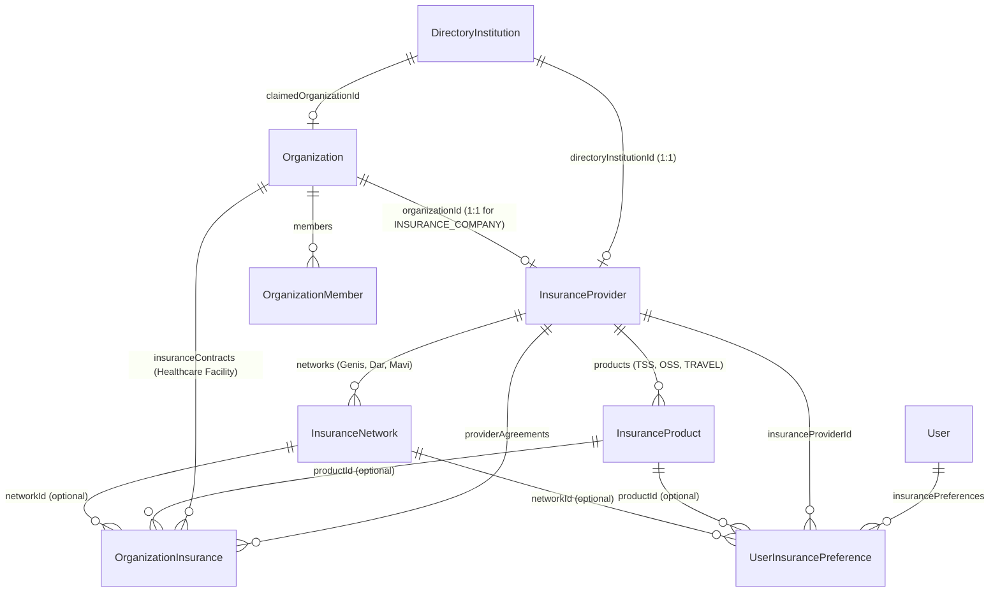

# ALUMAS — Insurance Ecosystem Integration: Architecture Audit & Implementation Blueprint

> **Document Status**: Architecture & Implementation Blueprint (Phase 0 Audit — No Code or Database Mutations Executed)  
> **Scope**: Insurance Companies (`Sigorta Kurumları`), Insurer Workspaces, Healthcare Provider Agreements, Patient Insurance Preferences, Insurance-Aware Discovery/Ranking, and Admin v2 Integration.

---

## 1. Verified Current Architecture & Precise File References

All findings below are verified against the active repository (`c:\active_projects\alumas\alumas.com`) and read-only inspection of the live database.

### 1.1 Database Schema (`prisma/schema.prisma`)

| Model / Enum | Lines | Current Definition & Role | Live DB Row Count |
| :--- | :--- | :--- | :--- |
| [`OrganizationType`](file:///c:/active_projects/alumas/alumas.com/prisma/schema.prisma#L385-L391) | `L385–391` | `HOSPITAL`, `CLINIC`, `PHARMACY`, `IMAGING_CENTER`, `LABORATORY`. Does **not** include `INSURANCE_COMPANY`. | — |
| [`VerificationDocumentType`](file:///c:/active_projects/alumas/alumas.com/prisma/schema.prisma#L459-L469) | `L459–469` | `DIPLOMA`, `SPECIALTY_CERTIFICATE`, `MINISTRY_REGISTRATION`, `ID_CARD`, `FACILITY_LICENSE`, `TRADE_REGISTRY`, `TAX_CERTIFICATE`, `TURSAB_CERTIFICATE`, `HEALTH_TOURISM_AUTHORIZATION`. | — |
| [`Organization`](file:///c:/active_projects/alumas/alumas.com/prisma/schema.prisma#L479-L539) | `L479–539` | Platform-managed or claimed institutions (`ownerId`, `type: OrganizationType`, `verificationStatus: VerificationStatus`, `isActive`, `isOnDuty`, `services`, `doctors`, `departments`, `stocks`, `bookings`, `insuranceContracts`, `claims`, `directoryListings`). | **12** (`APPROVED`) |
| [`DirectoryInstitution`](file:///c:/active_projects/alumas/alumas.com/prisma/schema.prisma#L714-L746) | `L714–746` | Normalized external/public institution directory (`type: OrganizationType`, `verificationTier: DirectoryVerificationTier`, `claimedOrganizationId`, `source`, `isPublished`). | **948** (`508` Hospital, `224` Clinic, `128` Pharmacy, `65` Lab, `23` Imaging) |
| [`InstitutionClaim`](file:///c:/active_projects/alumas/alumas.com/prisma/schema.prisma#L761-L780) | `L761–780` | Claim workflow linking `directoryInstitutionId`, `applicantUserId`, `organizationId`, and `status: ClaimRequestStatus` (`PENDING`, `APPROVED`, `REJECTED`, `REVOKED`). | Active claim records |
| [`InsuranceProvider`](file:///c:/active_projects/alumas/alumas.com/prisma/schema.prisma#L1225-L1236) | `L1225–1236` | Standalone catalog model (`id`, `name @unique`, `slug @unique`, `website`, `phone`, `description`, `isActive`, `createdAt`). Has **no link** to `Organization` or `DirectoryInstitution`. | **8** active rows (`allianz`, `bupa-acibadem`, `axa`, `anadolu`, `mapfre`, `sompo`, `turkiye-sigorta`, `alumas-demo-sigorta`) |
| [`OrganizationInsurance`](file:///c:/active_projects/alumas/alumas.com/prisma/schema.prisma#L1441-L1454) | `L1441–1454` | Junction table (`id`, `organizationId`, `insuranceProviderId`, `isActive`, `note`, `@@unique([organizationId, insuranceProviderId])`). | **1** row (`Lab Test` ↔ `Allianz Sigorta`, `note: "Sadece Dahiliye Bölümü"`) |
| [`UserInsurancePreference`](file:///c:/active_projects/alumas/alumas.com/prisma/schema.prisma#L1456-L1469) | `L1456–1469` | Patient preference model (`id`, `userId`, `insuranceProviderId`, `isPrimary`, `policyLabel`, `@@unique([userId, insuranceProviderId])`). | **0** rows (unwired in UI/API) |

### 1.2 Institution Onboarding, Claiming, Directory & Verification Files

- **[`lib/institution-directory.ts`](file:///c:/active_projects/alumas/alumas.com/lib/institution-directory.ts)**:
  - `ORG_TYPE_MAP` (`L74–80`) maps only the 5 medical facility types.
  - `isOrganizationVerifiedByAlumas` (`L82–100`) checks `org.verificationStatus === "APPROVED"` and verifies required documents via `missingRequiredDocuments()`.
  - `buildNormalizedDirectoryItems` (`L102–264`) merges `Organization` and `DirectoryInstitution` rows into a single deduplicated directory feed, suppressing claimed `DirectoryInstitution` rows when a linked `Organization` exists.
- **[`lib/verification-requirements.ts`](file:///c:/active_projects/alumas/alumas.com/lib/verification-requirements.ts)**:
  - `ORGANIZATION_DOCUMENTS` (`L8–12`) hardcodes `["FACILITY_LICENSE", "TRADE_REGISTRY", "TAX_CERTIFICATE"]` for **all** organizations, regardless of `OrganizationType`.
  - Requiring `FACILITY_LICENSE` (*Sağlık Tesisi Ruhsatı*) for an insurance company is domain-incorrect because Turkish insurers are licensed by **SEDDK** (*Sigortacılık ve Özel Emeklilik Düzenleme ve Denetleme Kurumu*) and registered with **TSB** (*Türkiye Sigorta Birliği*), not licensed as clinical facilities by the Ministry of Health.
- **[`app/api/organizations/route.ts`](file:///c:/active_projects/alumas/alumas.com/app/api/organizations/route.ts)**:
  - `GET`: Queries `queryNormalizedDirectory()` for `/organizations`. Does not accept insurance filter parameters (`insuranceProviderSlug`, `networkId`, or `fitForMyInsurance`).
  - `POST`: Handles both new institution applications and `claimDirectoryId` claims. Creates an `Organization` in `PENDING` state and an `InstitutionClaim` if claiming a `DirectoryInstitution`.
- **[`components/organization-directory.tsx`](file:///c:/active_projects/alumas/alumas.com/components/organization-directory.tsx)** & **[`app/organizations/[slug]/page.tsx`](file:///c:/active_projects/alumas/alumas.com/app/organizations/[slug]/page.tsx)**:
  - `/organizations` renders category filter pills, city/district filters, and 3-tier verification badges (`ALUMAS Onaylı`, `İncelemede`, `Harici Kayıt — Sahiplenilebilir`).
  - `/organizations/[slug]` (`L484–576`) already displays an *"Anlaşmalı Sigortalar"* card grid reading `organization.insuranceContracts`, including `contract.note`, and links to `/insurance`.
- **[`app/business/apply/page.tsx`](file:///c:/active_projects/alumas/alumas.com/app/business/apply/page.tsx)**, **[`app/business/[id]/page.tsx`](file:///c:/active_projects/alumas/alumas.com/app/business/[id]/page.tsx)** & **[`components/business/organization-manager.tsx`](file:///c:/active_projects/alumas/alumas.com/components/business/organization-manager.tsx)**:
  - `/business/apply` lets users register or claim an `Organization` and upload verification documents.
  - `OrganizationManager` (`L163–188`, `L1017–1080`) includes a basic *"Anlaşmalı Sigortalar"* accordion where an approved facility selects an `InsuranceProvider` from `/api/insurance`, enters a free-text `note`, and calls `POST /api/organizations/[id]/insurance` or `DELETE /api/organizations/[id]/insurance?providerId=...`.
  - However, the rest of `OrganizationManager` assumes a clinical facility (medical services, doctors, departments, lab tests, imaging exams, pharmacy stock, on-duty toggle, patient bookings).

---

## 2. Existing Insurance Functionality & Reuse Strategy (Single Source of Truth)

### 2.1 Audit of Existing Insurance Code

1. **[`app/insurance/page.tsx`](file:///c:/active_projects/alumas/alumas.com/app/insurance/page.tsx)**:
   - Server component querying `prisma.insuranceProvider.findMany({ where: { isActive: true } })`.
   - Renders a read-only grid of insurance cards (name, description, phone, website) and a static informational banner.
   - **Gaps**: No link to an insurer's institutional profile, no count or link to contracted hospitals/clinics, and no interactive patient preference selector (`Sigortamı Seç`).
2. **[`app/api/insurance/route.ts`](file:///c:/active_projects/alumas/alumas.com/app/api/insurance/route.ts)**:
   - Public `GET` returning active `InsuranceProvider` records ordered by `name`.
3. **[`app/api/organizations/[id]/insurance/route.ts`](file:///c:/active_projects/alumas/alumas.com/app/api/organizations/[id]/insurance/route.ts)**:
   - `POST` upserts `OrganizationInsurance` (`organizationId_insuranceProviderId`).
   - `DELETE` removes `OrganizationInsurance`.
   - **Real-World Finding in Live DB**: The single production contract (`Lab Test` ↔ `Allianz Sigorta`) has `note: "Sadece Dahiliye Bölümü"`. This proves that a flat boolean link per `[organizationId, insuranceProviderId]` is insufficient: agreements vary by **Product Type** (`TSS` vs `ÖSS`), **Network/Tier** (`Geniş Ağ` vs `Dar Ağ`), and **Specialty/Scope** (`ALL_BRANCHES` vs `SELECTED_SPECIALTIES`).
4. **[`lib/ai/match-engine.ts`](file:///c:/active_projects/alumas/alumas.com/lib/ai/match-engine.ts)** (`L115–208`):
   - `scoreContextualDoctorMatch()` already defines `insuranceMatch?: boolean | null` with weight `0.13` and dynamic weight normalization so `null` (unspecified insurance) never penalizes a provider.
5. **[`app/api/ai/facilities/live/route.ts`](file:///c:/active_projects/alumas/alumas.com/app/api/ai/facilities/live/route.ts)** & **[`app/api/ai/matches/route.ts`](file:///c:/active_projects/alumas/alumas.com/app/api/ai/matches/route.ts)**:
   - Both accept `insuranceProviderSlug` in the request payload, check `o.insuranceContracts.some(c => c.insuranceProvider.slug === insuranceProviderSlug)`, and boost matching facilities (`+15` points in `facilities/live`; `0.13` weighted factor in `matches`).
   - [`components/ai/LiveHealthResults.tsx`](file:///c:/active_projects/alumas/alumas.com/components/ai/LiveHealthResults.tsx) (`L326`) already renders a green `"Sigorta Uyumlu"` badge when `r.insuranceMatch === true`.
6. **[`app/nearby/page.tsx`](file:///c:/active_projects/alumas/alumas.com/app/nearby/page.tsx)** & **[`components/google-nearby-places.tsx`](file:///c:/active_projects/alumas/alumas.com/components/google-nearby-places.tsx)**:
   - Currently queries Google Places via `/api/places/nearby` without merging ALUMAS `Organization` insurance agreements or offering a *"Sigortama Uygun"* filter.

### 2.2 Single Source of Truth Decision (No Parallel Registries)

We must **not** create a duplicate insurer catalog alongside `InsuranceProvider`, nor treat `InsuranceProvider` as disconnected from `Organization` and `DirectoryInstitution`.

**Canonical Architecture**:
- **`InsuranceProvider` remains the canonical insurance catalog entity** referenced by healthcare agreements (`OrganizationInsurance`) and patient preferences (`UserInsurancePreference`).
- **`InsuranceProvider` is bridged 1:1 with the Institution Architecture**:
  - `InsuranceProvider.directoryInstitutionId` (`String? @unique`): Links each commercial insurer to its public `DirectoryInstitution` (`type = INSURANCE_COMPANY`) so insurers appear in `/organizations?type=INSURANCE_COMPANY` and can be claimed through the standard `InstitutionClaim` pipeline.
  - `InsuranceProvider.organizationId` (`String? @unique`): When an insurer claims its directory listing (or registers directly) and is approved, `InsuranceProvider.organizationId` links to the `Organization` (`type = INSURANCE_COMPANY`), unlocking the Insurer Workspace at `/business/[id]`.
- **`SGK` (Sosyal Güvenlik Kurumu) Separation**:
  - `SGK` is a public social security authority, **not** a commercial insurance company that private users can claim.
  - We distinguish `PayerKind` (`COMMERCIAL_INSURER` vs `PUBLIC_PAYER`) on `InsuranceProvider`. `SGK` is represented as `payerKind = PUBLIC_PAYER` (`isClaimable = false`) so hospitals/clinics can declare SGK agreements (`Tam Kapsam`, `Kısmi Branş`, `Acil`) and patients can filter by SGK + Tamamlayıcı Sağlık Sigortası (TSS), while preventing anyone from "claiming" SGK as a private business.

---

## 3. Proposed Entity Relationships & Normalized Prisma Schema Changes



### 3.1 Enum Extensions

```prisma
enum OrganizationType {
  HOSPITAL
  CLINIC
  PHARMACY
  IMAGING_CENTER
  LABORATORY
  INSURANCE_COMPANY // NEW: Commercial Health Insurer
}

enum VerificationDocumentType {
  DIPLOMA
  SPECIALTY_CERTIFICATE
  MINISTRY_REGISTRATION
  ID_CARD
  FACILITY_LICENSE
  TRADE_REGISTRY
  TAX_CERTIFICATE
  TURSAB_CERTIFICATE
  HEALTH_TOURISM_AUTHORIZATION
  INSURER_LICENSE      // NEW: SEDDK Faaliyet Ruhsatı / TSB Üyelik Belgesi
  AUTHORIZATION_LETTER // NEW: Kurumsal Yetki Belgesi / İmza Sirküleri
}

enum PayerKind {
  COMMERCIAL_INSURER // Allianz, Bupa Acıbadem, Axa, Anadolu, Türkiye Sigorta, etc.
  PUBLIC_PAYER       // SGK (Sosyal Güvenlik Kurumu) - non-claimable public payer
}

enum InsuranceProductKind {
  TSS                // Tamamlayıcı Sağlık Sigortası (SGK destekli)
  OSS                // Özel Sağlık Sigortası
  TRAVEL             // Seyahat Sağlık Sigortası
  FOREIGN_RESIDENT   // Yabancı Sağlık / İkamet Sigortası
  CORPORATE_GROUP    // Kurumsal Grup Sağlık Poliçesi
  CRITICAL_ILLNESS   // Tehlikeli Hastalıklar / Branş Bazlı Poliçe
}

enum AgreementCoverageScope {
  ALL_BRANCHES         // Tüm Branşlar (Yatarak + Ayakta)
  SELECTED_SPECIALTIES // Belirli Branşlar (e.g. "Sadece Dahiliye Bölümü")
  INPATIENT_ONLY       // Sadece Yatarak Tedavi
  OUTPATIENT_ONLY      // Sadece Ayakta Tedavi
  EMERGENCY_ONLY       // Sadece Acil Kapsamı
}

enum AgreementVerificationStatus {
  SELF_DECLARED_BY_PROVIDER // Sağlık kurumu beyan etti (Kurum Beyanı)
  SELF_DECLARED_BY_INSURER  // Sigorta şirketi beyan etti (Sigorta Beyanı)
  MUTUALLY_CONFIRMED        // Hem sağlık kurumu hem sigorta şirketi onayladı
  ADMIN_VERIFIED            // ALUMAS Admin tarafından resmi kaynakla doğrulandı
  DISPUTED                  // Taraflardan biri anlaşmayı reddetti / uyuşmazlık var
  EXPIRED                   // Geçerlilik süresi doldu
}

enum OrganizationMemberRole {
  OWNER
  ADMIN
  NETWORK_MANAGER // Manages insurance agreements & networks without full org ownership
  STAFF
}
```

### 3.2 Model Extensions & New Normalized Models

#### A. Evolved `InsuranceProvider`
```prisma
model InsuranceProvider {
  id                     String                      @id @default(cuid())
  name                   String                      @unique
  slug                   String                      @unique
  payerKind              PayerKind                   @default(COMMERCIAL_INSURER)
  tsbCode                String?                     @unique // Türkiye Sigorta Birliği resmi şirket kodu
  taxNumber              String?                     // VKN / MERSİS
  logoUrl                String?
  website                String?
  phone                  String?
  claimsPhone            String?                     // Provizyon / Anlaşmalı Kurum Destek Hattı
  provisionPortalUrl     String?                     // Kurum / Hasta provizyon portal adresi
  headquartersCity       String?
  headquartersDistrict   String?
  headquartersAddress    String?
  description            String?
  isClaimable            Boolean                     @default(true) // false for SGK
  isActive               Boolean                     @default(true)
  source                 String                      @default("ALUMAS_CURATED") // TSB_REGISTRY, SEDDK, MANUAL
  lastVerifiedAt         DateTime?
  organizationId         String?                     @unique
  directoryInstitutionId String?                     @unique
  createdAt              DateTime                    @default(now())
  updatedAt              DateTime                    @updatedAt

  organization           Organization?               @relation("InsurerOrganization", fields: [organizationId], references: [id], onDelete: SetNull)
  directoryInstitution   DirectoryInstitution?       @relation("InsurerDirectoryListing", fields: [directoryInstitutionId], references: [id], onDelete: SetNull)
  products               InsuranceProduct[]
  networks               InsuranceNetwork[]
  organizationLinks      OrganizationInsurance[]
  userPreferences        UserInsurancePreference[]

  @@index([payerKind, isActive])
}
```

#### B. `InsuranceProduct` & `InsuranceNetwork`
```prisma
model InsuranceProduct {
  id                  String                  @id @default(cuid())
  insuranceProviderId String
  kind                InsuranceProductKind
  code                String                  // e.g. "TSS_STANDART", "OSS_PLATINUM"
  name                String                  // e.g. "Tamamlayıcı Sağlık Sigortası", "Özel Sağlık Sigortası"
  description         String?
  requiresSgk         Boolean                 @default(false) // true for TSS
  isActive            Boolean                 @default(true)
  createdAt           DateTime                @default(now())
  updatedAt           DateTime                @updatedAt

  insuranceProvider   InsuranceProvider       @relation(fields: [insuranceProviderId], references: [id], onDelete: Cascade)
  networks            InsuranceNetwork[]
  agreements          OrganizationInsurance[]
  userPreferences     UserInsurancePreference[]

  @@unique([insuranceProviderId, code])
  @@index([insuranceProviderId, kind, isActive])
}

model InsuranceNetwork {
  id                  String                  @id @default(cuid())
  insuranceProviderId String
  productId           String?                 // Optional: network can be shared across products or tied to one
  name                String                  // e.g. "Geniş Ağ (A Plus)", "Dar / Seçkin Ağ", "Mavi Ağ"
  slug                String                  // e.g. "genis-ag", "dar-ag", "mavi-ag"
  tierLevel           Int                     @default(1) // 1 = Broadest/Comprehensive, 2 = Standard, 3 = Narrow/Economy
  description         String?
  isActive            Boolean                 @default(true)
  createdAt           DateTime                @default(now())
  updatedAt           DateTime                @updatedAt

  insuranceProvider   InsuranceProvider       @relation(fields: [insuranceProviderId], references: [id], onDelete: Cascade)
  product             InsuranceProduct?       @relation(fields: [productId], references: [id], onDelete: SetNull)
  agreements          OrganizationInsurance[]
  userPreferences     UserInsurancePreference[]

  @@unique([insuranceProviderId, slug])
  @@index([insuranceProviderId, isActive])
}
```

#### C. Evolved `OrganizationInsurance` (Backward-Compatible Provider ↔ Insurer Agreement)
By evolving `OrganizationInsurance` in place (with defaults for all new fields), every existing query (`organization.insuranceContracts`, `/api/organizations/[id]/insurance`, `/api/ai/facilities/live`) continues working without regression while unlocking product, network, specialty scope, and dual-party verification:

```prisma
model OrganizationInsurance {
  id                  String                      @id @default(cuid())
  organizationId      String
  insuranceProviderId String
  productId           String?
  networkId           String?
  productKinds        InsuranceProductKind[]      @default([OSS, TSS]) // Quick filter array for TSS/OSS
  coverageScope       AgreementCoverageScope      @default(ALL_BRANCHES)
  includedSpecialties String[]                    @default([]) // e.g. ["INTERNAL_MEDICINE"]
  excludedSpecialties String[]                    @default([])
  copayNote           String?                     // Katılım payı / fark ücreti notu
  note                String?                     // Preserved existing field (e.g. "Sadece Dahiliye Bölümü")
  verificationStatus  AgreementVerificationStatus @default(SELF_DECLARED_BY_PROVIDER)
  declaredByUserId    String?
  confirmedByUserId   String?
  validFrom           DateTime?
  validUntil          DateTime?
  lastVerifiedAt      DateTime                    @default(now())
  sourceUrl           String?                     // Official insurer network page URL if externally verified
  isActive            Boolean                     @default(true)
  createdAt           DateTime                    @default(now())
  updatedAt           DateTime                    @updatedAt

  organization        Organization                @relation(fields: [organizationId], references: [id], onDelete: Cascade)
  insuranceProvider   InsuranceProvider           @relation(fields: [insuranceProviderId], references: [id], onDelete: Cascade)
  product             InsuranceProduct?           @relation(fields: [productId], references: [id], onDelete: SetNull)
  network             InsuranceNetwork?           @relation(fields: [networkId], references: [id], onDelete: SetNull)

  @@unique([organizationId, insuranceProviderId, networkId]) // Note: null networkId handled via partial index or default sentinel in migration
  @@index([insuranceProviderId, isActive, verificationStatus])
  @@index([organizationId, isActive])
  @@index([networkId, isActive])
}
```
> **Uniqueness Note for PostgreSQL**: Because PostgreSQL treats `NULL` as distinct in standard `UNIQUE` indexes unless `NULLS NOT DISTINCT` is used, our migration will retain a primary summary agreement per `(organizationId, insuranceProviderId)` with `networkIds String[] @default([])` **or** use PostgreSQL 15+ `UNIQUE NULLS NOT DISTINCT (organizationId, insuranceProviderId, networkId)`. To guarantee 100% compatibility with existing `upsert({ where: { organizationId_insuranceProviderId } })` calls in `app/api/organizations/[id]/insurance/route.ts`, keeping `@@unique([organizationId, insuranceProviderId])` on `OrganizationInsurance` and storing `productKinds InsuranceProductKind[]` + a relation `acceptedNetworks InsuranceNetwork[]` (implicit many-to-many) is the cleanest, zero-regression design! Let us adopt that exact structure:
> - `OrganizationInsurance` keeps `@@unique([organizationId, insuranceProviderId])` (1 canonical agreement record per facility-insurer pair).
> - `OrganizationInsurance` has `productKinds InsuranceProductKind[]`, `acceptedNetworks InsuranceNetwork[]` (many-to-many), `coverageScope AgreementCoverageScope`, `includedSpecialties String[]`, `excludedSpecialties String[]`, `verificationStatus AgreementVerificationStatus`, `lastVerifiedAt DateTime`, `validUntil DateTime?`.
> - This avoids combinatorial explosion of rows per hospital while allowing exact network and specialty matching.

#### D. Evolved `UserInsurancePreference`
```prisma
model UserInsurancePreference {
  id                  String                @id @default(cuid())
  userId              String
  insuranceProviderId String
  productKind         InsuranceProductKind? // e.g. TSS or OSS
  productId           String?
  networkId           String?
  hasSgkCoverage      Boolean               @default(true)
  isPrimary           Boolean               @default(true)
  policyLabel         String?               // User nickname only (e.g. "Kurumsal Tamamlayıcı"), NEVER policy/TC number
  createdAt           DateTime              @default(now())
  updatedAt           DateTime              @updatedAt

  user                User                  @relation(fields: [userId], references: [id], onDelete: Cascade)
  insuranceProvider   InsuranceProvider     @relation(fields: [insuranceProviderId], references: [id], onDelete: Cascade)
  product             InsuranceProduct?     @relation(fields: [productId], references: [id], onDelete: SetNull)
  network             InsuranceNetwork?     @relation(fields: [networkId], references: [id], onDelete: SetNull)

  @@unique([userId, insuranceProviderId])
  @@index([userId, isPrimary])
}
```

#### E. Workspace Membership (`OrganizationMember`)
To avoid mutating global `User.role` unsafely when granting staff access to an insurer or hospital workspace:
```prisma
model OrganizationMember {
  id             String                 @id @default(cuid())
  organizationId String
  userId         String
  role           OrganizationMemberRole @default(ADMIN)
  title          String?
  isActive       Boolean                @default(true)
  createdAt      DateTime               @default(now())
  updatedAt      DateTime               @updatedAt

  organization   Organization           @relation(fields: [organizationId], references: [id], onDelete: Cascade)
  user           User                   @relation(fields: [userId], references: [id], onDelete: Cascade)

  @@unique([organizationId, userId])
  @@index([userId, isActive])
}
```

---

## 4. Insurance Company Registration, Claiming & Verification Flow

### 4.1 Directory Presence (`DirectoryInstitution` ↔ `InsuranceProvider`)
- Every active commercial `InsuranceProvider` (excluding test/demo records in public views unless enabled, and excluding `SGK` from claimable commercial cards) is linked 1:1 to a `DirectoryInstitution` with `type = INSURANCE_COMPANY`.
- In `/organizations`, users can filter by **`Sigorta Kurumu`** (`INSURANCE_COMPANY`) alongside Hospital, Clinic, Pharmacy, Laboratory, and Imaging Center.
- Unclaimed insurers display the standard `EXTERNAL_UNCLAIMED` badge (*"Harici Kayıt — Sahiplenilebilir"*) with a **"Kurumu Sahiplen"** button linking to `/business/apply?claimDirectoryId=<id>`.

### 4.2 Type-Aware Document Verification (`lib/verification-requirements.ts`)
Instead of a single static `ORGANIZATION_DOCUMENTS` array for all `OrganizationType` values, `lib/verification-requirements.ts` will resolve required documents by `OrganizationType`:

| `OrganizationType` | Required Verification Documents |
| :--- | :--- |
| `HOSPITAL`, `CLINIC`, `PHARMACY`, `IMAGING_CENTER`, `LABORATORY` | `FACILITY_LICENSE`, `TRADE_REGISTRY`, `TAX_CERTIFICATE` *(Unchanged)* |
| `INSURANCE_COMPANY` | `INSURER_LICENSE` (*SEDDK Faaliyet Ruhsatı / TSB Üyelik Belgesi*), `TRADE_REGISTRY` (*Ticaret Sicil Gazetesi*), `TAX_CERTIFICATE` (*Vergi Levhası*), `AUTHORIZATION_LETTER` (*Kurumsal Yetki Belgesi / İmza Sirküleri*) |

### 4.3 Identity & Domain Verification Safeguards
When a user submits a claim or application for `type = INSURANCE_COMPANY`:
1. **Corporate Email Domain Match Signal**: The backend compares the applicant's email domain (e.g., `@allianz.com.tr`) against the target `InsuranceProvider.website` domain (`allianz.com.tr`). A mismatch does not hard-block submission (since legal representatives may apply), but flags `domainMismatchWarning: true` in the Admin v2 Claim Review Drawer, identical in spirit to our Doctor Claim identity-mismatch safeguard.
2. **Single Active Claim Lock**: Existing `InstitutionClaim` uniqueness and lock rules prevent concurrent conflicting claims on the same insurer.
3. **Admin Approval Hook**: When an Admin approves an `INSURANCE_COMPANY` organization/claim in `/admin/organizations`:
   - `Organization.verificationStatus` becomes `APPROVED`.
   - `DirectoryInstitution.claimedOrganizationId` and `verificationTier = ALUMAS_VERIFIED` are set.
   - `InsuranceProvider.organizationId` is automatically linked (or created if it was a brand-new insurer application), and an `AuditLog` entry (`APPROVE_INSURER_CLAIM`) is recorded.

---

## 5. Insurer Workspace Capabilities (`/business/[id]`)

When an authenticated owner or `OrganizationMember` opens `/business/[id]` for an `Organization` where `type === "INSURANCE_COMPANY"`, `OrganizationManager` renders a dedicated **Insurer Workspace** instead of clinical facility tabs:

### 5.1 What is Hidden for `INSURANCE_COMPANY`
- Medical Services & Pricing (`OrganizationService`)
- Clinical Departments (`Department`)
- Rostered Doctors (`OrganizationDoctor`)
- Pharmacy Inventory & On-Duty Toggle (`MedicineStock`, `isOnDuty`)
- Laboratory Tests & Imaging Exams (`LaboratoryTest`, `ImagingExam`)
- Patient Clinical Bookings (`OrganizationBooking`)

### 5.2 What is Shown in the Insurer Workspace
1. **Kurumsal Sigorta Profili (Insurer Profile & Provision Channels)**:
   - Official Company Name, TSB Code, Logo, Website, Customer Service Phone, Provision/Institution Support Phone (`claimsPhone`), Online Provision Portal URL (`provisionPortalUrl`), Headquarters Address, and Description.
2. **Sigorta Ürünleri (Insurance Products — TSS / ÖSS / Seyahat / Yabancı Sağlık)**:
   - CRUD for `InsuranceProduct` records (`kind`, `name`, `code`, `requiresSgk`, `description`, `isActive`).
3. **Sigorta Ağları ve Kapsam Grupları (Insurance Networks / Tiers)**:
   - CRUD for `InsuranceNetwork` records (e.g., *Geniş Ağ*, *Dar/Seçkin Ağ*, *Mavi Ağ*, *Sarı Ağ*) with `tierLevel` and description.
4. **Anlaşmalı Sağlık Kurumları Yönetimi (Contracted Healthcare Providers Matrix)**:
   - Searchable, paginated table of all `OrganizationInsurance` records linked to this insurer.
   - **Add Agreement**: Insurer can select any ALUMAS `Organization` (Hospital, Clinic, Lab, Imaging Center, Pharmacy), specify covered `productKinds` (`TSS`, `OSS`), `acceptedNetworks`, `coverageScope` (`ALL_BRANCHES`, `SELECTED_SPECIALTIES`, etc.), `includedSpecialties`, and `validUntil`. Saves as `SELF_DECLARED_BY_INSURER` (or `MUTUALLY_CONFIRMED` if the provider already declared it).
   - **Verify / Dispute Provider Declarations**: Filter tab for `SELF_DECLARED_BY_PROVIDER` agreements where hospitals/clinics claimed an agreement with this insurer. One-click **Onayla (`MUTUALLY_CONFIRMED`)** or **Uyuşmazlık Bildir (`DISPUTED`)** with audit logging.
5. **Doğrulama Belgeleri (Verification Documents)**:
   - Upload and status tracking for `INSURER_LICENSE`, `TRADE_REGISTRY`, `TAX_CERTIFICATE`, `AUTHORIZATION_LETTER`.

---

## 6. Healthcare Organization Insurance Agreement Management

In `components/business/organization-manager.tsx`, the existing *"Anlaşmalı Sigortalar"* section (`L1017–1080`) for Hospitals, Clinics, Laboratories, Imaging Centers, and Pharmacies will be upgraded from a simple dropdown + free-text note into a structured **Sigorta ve Kurum Anlaşmaları** manager:

1. **Insurer & Public Payer Selector**:
   - Select from active `InsuranceProvider` records (including `SGK` and commercial insurers).
2. **Product Coverage Checkboxes (`productKinds`)**:
   - Multi-select chips: `ÖSS (Özel Sağlık)`, `TSS (Tamamlayıcı Sağlık)`, `Seyahat Sağlık`, `Yabancı Sağlık`.
3. **Network / Tier Selection (`acceptedNetworks`)**:
   - Dynamically loads the selected insurer's `InsuranceNetwork` options (if defined by the insurer/admin, e.g., *Geniş Ağ*, *Dar Ağ*). Defaults to *"Tüm Ağlar / Genel Anlaşma"* if no specific network restriction applies.
4. **Branch & Service Scope (`coverageScope` + `includedSpecialties`)**:
   - Radio/Select:
     - `ALL_BRANCHES` (*Tüm Branşlarda Geçerli*)
     - `SELECTED_SPECIALTIES` (*Belirli Branşlarda Geçerli* — opens multi-select of canonical ALUMAS medical specialties, replacing unstructured notes like `"Sadece Dahiliye Bölümü"` with structured `["INTERNAL_MEDICINE"]` while keeping `note` for human-readable details)
     - `INPATIENT_ONLY` (*Sadece Yatarak Tedavi*)
     - `OUTPATIENT_ONLY` (*Sadece Ayakta Tedavi*)
     - `EMERGENCY_ONLY` (*Sadece Acil Kapsamı*)
5. **Verification Badge & Freshness**:
   - Displays whether the agreement is `Kurum Beyanı` (`SELF_DECLARED_BY_PROVIDER`), `Karşılıklı Onaylı` (`MUTUALLY_CONFIRMED`), or `ALUMAS Doğrulanmış` (`ADMIN_VERIFIED`), plus a **"Güncelliği Onayla"** button that refreshes `lastVerifiedAt`.

---

## 7. Patient Insurance Preference UX & Persistence

### 7.1 Data Minimization & Privacy By Design
- Patients **never** enter T.C. Kimlik No, policy numbers, member card numbers, or upload policy PDFs.
- Patients only store discovery preferences:
  - Selected `InsuranceProvider` (e.g., *Allianz Sigorta*)
  - Optional `productKind` (`TSS` or `OSS`)
  - Optional `networkId` (e.g., *Geniş Ağ* or *"Ağımı Bilmiyorum / Genel"*)
  - `hasSgkCoverage` boolean toggle (`SGK Güvencem Var`)
  - Optional user-friendly nickname (`policyLabel`, e.g., *"Şirket TSS"*).

### 7.2 API & Dual-Persistence Model
- **New Endpoint**: `GET / POST / DELETE /api/user/insurance-preferences`
  - **Authenticated Users**: Persisted in `UserInsurancePreference` in PostgreSQL (supporting multiple policies with one marked `isPrimary = true`).
  - **Anonymous / Guest Visitors**: Stored in a lightweight client-side local storage / cookie key (`alumas_insurance_pref_v1`) so guests can immediately use *"Sigortama Uygun"* filters on `/organizations`, `/nearby`, and `/insurance`, and seamlessly sync to `UserInsurancePreference` upon login.

### 7.3 Where Patients Manage & Use Preferences
1. **`/insurance` Page Upgrade**:
   - Transforms `/insurance` from a static brochure into an interactive **Sigorta Ekosistemi & Anlaşmalı Kurum Rehberi**:
     - **"Sigortamı Seç / Kaydet" Bar**: Top interactive bar allowing the user to pick their primary insurer, TSS/ÖSS type, and SGK status in 2 clicks.
     - **Insurer Cards**: Each card now displays the count of contracted healthcare institutions on ALUMAS, supported product badges (`TSS`, `ÖSS`), a **"Sigortam Olarak Seç"** toggle, a **"Anlaşmalı Kurumları Gör"** button (linking to `/organizations?insurance=allianz`), and a link to the insurer's institutional profile (`/organizations/[insurer-slug]`).
2. **`/profile` Page**:
   - Dedicated *"Sigorta Tercihlerim"* card allowing logged-in users to manage primary/secondary insurance preferences.
3. **Clear Legal/UX Disclaimer**:
   - Every insurance badge and preference selector displays a concise tooltip/disclaimer:
     > *"Sigorta uyumu kurum ve sigorta beyanlarına göre bilgilendirme amaçlıdır. Kesin poliçe kapsamı ve katılım payı işlem öncesi provizyon onayına tabidir."*

---

## 8. Insurance-Aware Search, Filter & Ranking Architecture

### 8.1 Three-Tier Match Classification
Every evaluated healthcare provider or doctor is classified into one of four deterministic insurance states relative to the active insurance context (`insuranceProviderSlug`, optional `productKind`, optional `networkId`, optional `specialty`):

| Match Tier | Condition | UI Badge | Ranking Boost |
| :--- | :--- | :--- | :--- |
| **`CONFIRMED_MATCH`** | Active non-expired agreement where `verificationStatus` is `MUTUALLY_CONFIRMED` or `ADMIN_VERIFIED`, matching insurer (+ product/network/specialty if specified). | **Sigortanızla Anlaşmalı (Onaylı)** *(Emerald Badge)* | **Full Boost (`1.0`)** |
| **`DECLARED_MATCH`** | Active non-expired agreement where `verificationStatus` is `SELF_DECLARED_BY_PROVIDER` or `SELF_DECLARED_BY_INSURER`, matching insurer (+ product/network/specialty). | **Sigorta Uyumlu (Kurum Beyanı)** *(Blue/Teal Badge)* | **Partial Boost (`0.75`)** |
| **`PARTIAL_OR_BRANCH_LIMITED`** | Agreement exists with insurer, but is restricted to other specialties (`SELECTED_SPECIALTIES` not matching query) or `EMERGENCY_ONLY`. | **Kısmi / Branş Kısıtlı Anlaşma** *(Amber Badge)* | **Minimal Boost (`0.25`)** |
| **`UNKNOWN_OR_NO_MATCH`** | Unclaimed external `DirectoryInstitution` or `Organization` with no recorded agreement for this insurer. | *No badge (or "Anlaşma Bilgisi Yok" when filter active)* | **Neutral (`0.0` — No Penalty)** |

### 8.2 Discovery Surfaces Integration
1. **`/organizations` (`components/organization-directory.tsx` & `lib/institution-directory.ts`)**:
   - **Category Filter**: Adds `Sigorta Kurumu` (`INSURANCE_COMPANY`) to institution type pills.
   - **Insurance Filter Bar**:
     - Quick toggle: **"Sigortama Uygun"** (auto-uses saved preference or opens inline insurer selector).
     - Dropdowns: Sigorta Şirketi (`insurance`), Poliçe Türü (`TSS` / `OSS`),Strict Mode checkbox (**"Yalnızca Anlaşmalı Kurumları Göster"** vs default **"Anlaşmalı Kurumları Öne Çıkar"**).
2. **`/nearby` (`app/nearby/page.tsx` & `app/api/places/nearby/route.ts`)**:
   - Enriches nearby results by cross-matching returned facilities against ALUMAS `Organization` records (by coordinates proximity + normalized name/slug) and attaching `insuranceMatchTier` and contracted insurer badges.
   - Adds a **"Sigortama Uygun"** filter pill in the Nearby toolbar so patients looking for a nearby hospital or clinic immediately see which ones accept their insurance.
3. **AI Health Navigator & Doctor/Facility Matching (`lib/ai/match-engine.ts`, `/api/ai/facilities/live`, `/api/ai/matches`)**:
   - If the request payload does not explicitly pass `insuranceProviderSlug`, the API automatically falls back to the authenticated user's primary `UserInsurancePreference`.
   - `scoreContextualDoctorMatch()` is upgraded to accept `insuranceMatchTier?: "CONFIRMED" | "DECLARED" | "PARTIAL" | "NONE" | null` (remaining backward-compatible with `boolean | null`).
   - Specialty restriction check: If a user searches for `CARDIOLOGY` and the hospital's agreement has `coverageScope = SELECTED_SPECIALTIES` with `includedSpecialties = ["INTERNAL_MEDICINE"]`, the match engine downgrades the match from `CONFIRMED` to `PARTIAL` and surfaces the scope note (`"Sadece Dahiliye Bölümü"`).

### 8.3 Concrete Ranking Formula & Scenarios

In `lib/ai/match-engine.ts`, the composite score is:

$$S_{\text{total}} = \frac{\sum_{i} w_i \cdot s_i}{\sum_{i \in \text{active}} w_i} \times 100$$

Where weights are:
- Specialty Match ($w_{\text{spec}} = 0.27$)
- Location Proximity ($w_{\text{loc}} = 0.16$)
- Rating Quality ($w_{\text{qual}} = 0.15$)
- Availability ($w_{\text{avail}} = 0.14$)
- **Insurance Match ($w_{\text{ins}} = 0.13$)**:
  - `CONFIRMED_MATCH` $\rightarrow s_{\text{ins}} = 1.00$
  - `DECLARED_MATCH` $\rightarrow s_{\text{ins}} = 0.75$
  - `PARTIAL_OR_BRANCH_LIMITED` $\rightarrow s_{\text{ins}} = 0.25$
  - `NONE` (when user has selected an insurer) $\rightarrow s_{\text{ins}} = 0.00$
  - `null` (user has no insurer selected) $\rightarrow$ weight $w_{\text{ins}}$ is excluded from the denominator so unconfigured users experience zero score distortion.
- Platform Verification ($w_{\text{ver}} = 0.10$)
- Budget Compatibility ($w_{\text{bud}} = 0.05$)

#### Sample Ranking Scenarios:
1. **Scenario A — Exact Network & Specialty Match**:
   - User has *Allianz Sigorta — TSS — Geniş Ağ* and searches for *Dahiliye (Internal Medicine)* in Istanbul.
   - *Hospital A* has a `MUTUALLY_CONFIRMED` Allianz TSS agreement in *Geniş Ağ* covering `ALL_BRANCHES`. It receives $s_{\text{ins}} = 1.00$ (+13 normalized points) and displays **"Allianz Sigorta (TSS) — Onaylı Anlaşma"**.
2. **Scenario B — Specialty-Restricted Agreement (Live DB Case)**:
   - Organization `Lab Test` has an Allianz agreement with `coverageScope = SELECTED_SPECIALTIES`, `includedSpecialties = ["INTERNAL_MEDICINE"]`, `note = "Sadece Dahiliye Bölümü"`.
   - For an *Internal Medicine* query, `Lab Test` receives `DECLARED_MATCH` ($s_{\text{ins}} = 0.75$).
   - For an *Orthopedics* query, `Lab Test` is downgraded to `PARTIAL_OR_BRANCH_LIMITED` ($s_{\text{ins}} = 0.25$) with badge **"Branş Kısıtlı: Sadece Dahiliye Bölümü"**.
3. **Scenario C — Missing Network Fallback**:
   - User selects *Bupa Acıbadem Sigorta* without knowing their network tier (`networkId = null`).
   - Any facility with an active *Bupa Acıbadem* agreement matches; if the agreement is restricted to a narrow network, the UI badge notes *"Ağ Kapsamını Kontrol Edin"*.
4. **Scenario D — Expired Agreement Handling**:
   - An agreement with `validUntil < NOW()` or `verificationStatus = EXPIRED` receives $s_{\text{ins}} = 0.00$ and is never badged as active.

---

## 9. Admin v2 Integration

In accordance with the completed **Admin v2 Four-Hub Architecture**, we will **not** clutter the top-level sidebar with redundant standalone pages. Instead, insurance management integrates cleanly into **Hub 2: Sağlık Ağı & Dizin (`Healthcare Network & Directory`)**:

1. **`/admin/organizations` Upgrade**:
   - **Type Filter & Tab**: Adds `INSURANCE_COMPANY` (*Sigorta Kurumları*) to the existing organization type filter and directory tab (`Platform Kurumları`, `Dış Dizin Kurumları`, `Sahiplenme Talepleri`).
   - **Insurer Claim Verification**: When reviewing an `InstitutionClaim` or pending `Organization` of type `INSURANCE_COMPANY`, the document checklist automatically validates `INSURER_LICENSE`, `TRADE_REGISTRY`, `TAX_CERTIFICATE`, and `AUTHORIZATION_LETTER`, and shows the corporate email domain match badge.
   - **Insurer & Agreement Management Drawer**:
     - For `INSURANCE_COMPANY` records: Admins can edit `tsbCode`, `payerKind`, `claimsPhone`, `provisionPortalUrl`, manage `InsuranceProduct` / `InsuranceNetwork` catalogs, and review/verify `OrganizationInsurance` agreements (`ADMIN_VERIFIED` override or dispute resolution).
     - For Healthcare Facilities (`HOSPITAL`, `CLINIC`, etc.): The existing Organization Detail Drawer gains an **"Anlaşmalı Sigortalar"** section where Admins can inspect, verify (`ADMIN_VERIFIED`), or remove declared insurance contracts.
2. **Admin Audit Logging (`AuditLog`)**:
   - All admin mutations on insurer records, claims, products, networks, and agreement verifications write structured `AuditLog` entries via `logAdminAction()` (`UPDATE_INSURER`, `VERIFY_INSURANCE_AGREEMENT`, `DISPUTE_INSURANCE_AGREEMENT`).

---

## 10. Data Provenance, Verification & Freshness Rules

1. **Authoritative Turkish Data Sources**:
   - **SEDDK** (*Sigortacılık ve Özel Emeklilik Düzenleme ve Denetleme Kurumu*) & **TSB** (*Türkiye Sigorta Birliği*): Official registry of licensed health insurance companies in Turkey (`source = "TSB_REGISTRY"`).
   - **SGK** (*Sosyal Güvenlik Kurumu*): Represented as `payerKind = PUBLIC_PAYER`, `isClaimable = false`.
   - **Demo / Test Insurer Isolation**: The existing production row `Alumas Demo Sigorta` (`cmtkaf9rp0089ypj4t4680pc9`) will be preserved for non-destructive safety, but marked or filtered so public patient discovery prioritizes real licensed insurers while keeping test data isolated.
2. **Freshness & Expiration Policy**:
   - Every `OrganizationInsurance` tracks `lastVerifiedAt` and optional `validUntil`.
   - **> 180 Days Since `lastVerifiedAt`**: Marked as *"Güncellik Teyidi Bekliyor"* in the provider/insurer workspace with a one-click re-confirmation prompt.
   - **Past `validUntil`**: Automatically treated as `EXPIRED` in discovery queries (`validUntil IS NULL OR validUntil > NOW()`).

---

## 11. Privacy, KVKK & Authorization Considerations

1. **Strict KVKK Compliance (`UserInsurancePreference`)**:
   - Zero collection of T.C. Kimlik No, policy numbers, health history, or insurance documents.
   - Preferences are strictly user-scoped (`session.user.id === preference.userId`). Neither hospitals nor insurance companies can query individual users' `UserInsurancePreference` records.
2. **Workspace Authorization (`/api/organizations/[id]/...`)**:
   - Reusable helper `requireOrganizationWorkspaceAccess(organizationId, allowedRoles)`:
     - Grants access if `session.user.role === "ADMIN"`, `organization.ownerId === session.user.id`, or an active `OrganizationMember` row exists for `(organizationId, session.user.id)`.
   - Dual-party agreement rules:
     - Healthcare providers can create/edit agreements for their own `organizationId` (sets status to `SELF_DECLARED_BY_PROVIDER`, or `MUTUALLY_CONFIRMED` if already declared by the insurer).
     - Approved Insurer workspaces can create/confirm/dispute agreements where `insuranceProvider.organizationId === insurerOrg.id`.
     - Only ALUMAS `ADMIN` can set `verificationStatus = ADMIN_VERIFIED`.

---

## 12. Incremental Migration & Backward-Compatibility Strategy

To guarantee **zero downtime and zero data loss** across all 948 `DirectoryInstitution`, 12 `Organization`, 8 `InsuranceProvider`, and 1 `OrganizationInsurance` records:

1. **Step 1 — Non-Destructive Additive Prisma Migration**:
   - Add new enum values (`OrganizationType.INSURANCE_COMPANY`, `VerificationDocumentType.INSURER_LICENSE`, `VerificationDocumentType.AUTHORIZATION_LETTER`) and new enums (`PayerKind`, `InsuranceProductKind`, `AgreementCoverageScope`, `AgreementVerificationStatus`, `OrganizationMemberRole`).
   - Add nullable/defaulted columns to `InsuranceProvider`, `OrganizationInsurance`, and `UserInsurancePreference`.
   - Create `InsuranceProduct`, `InsuranceNetwork`, and `OrganizationMember` tables.
2. **Step 2 — Idempotent Catalog Synchronization Script**:
   - Link the existing 7 real `InsuranceProvider` rows (`Allianz`, `Bupa Acıbadem`, `Axa`, `Anadolu`, `Mapfre`, `Sompo`, `Türkiye Sigorta`) to corresponding `DirectoryInstitution` rows (`type = INSURANCE_COMPANY`, `source = "TSB_REGISTRY"`), and seed standard initial products (`TSS`, `OSS`) and default networks (`Geniş Ağ`, `Dar/Seçkin Ağ`).
   - Add `SGK (Sosyal Güvenlik Kurumu)` as `payerKind = PUBLIC_PAYER`, `isClaimable = false`.
   - Preserve the existing `Lab Test` ↔ `Allianz Sigorta` agreement (`note: "Sadece Dahiliye Bölümü"`), enriching it with `coverageScope = SELECTED_SPECIALTIES` and `includedSpecialties = ["INTERNAL_MEDICINE"]`.

---

## 13. Concrete Implementation Phases & Verification Test Plan

### Phase 1: Schema, Catalog Synchronization & Verification Rules
- Apply additive Prisma migration.
- Run idempotent sync linking `InsuranceProvider` ↔ `DirectoryInstitution` (`INSURANCE_COMPANY`) and migrating the existing `OrganizationInsurance` row.
- Update `lib/verification-requirements.ts` and `lib/institution-directory.ts` for `INSURANCE_COMPANY`.

### Phase 2: Insurer Onboarding, Workspace & Provider Agreement Upgrade
- Update `/business/apply` and `/api/organizations` to support `INSURANCE_COMPANY` registration/claiming with `INSURER_LICENSE` and `AUTHORIZATION_LETTER`.
- Upgrade `components/business/organization-manager.tsx`:
  - Render the **Insurer Workspace** (Profile, Products, Networks, Contracted Providers & Confirmations) when `org.type === "INSURANCE_COMPANY"`.
  - Upgrade the **Provider Insurance Agreement Editor** (TSS/ÖSS products, networks, specialty scope) for clinical organizations.
- Add `/api/insurers/[id]/agreements`, `/api/insurers/[id]/products`, and `/api/insurers/[id]/networks`.

### Phase 3: Patient Insurance Preferences & Insurance-Aware Discovery
- Implement `/api/user/insurance-preferences` + client preference hook (DB + local storage fallback).
- Upgrade `/insurance` into an interactive ecosystem hub with preference selection and contracted provider links.
- Add *"Sigortama Uygun"* and `INSURANCE_COMPANY` filters to `/organizations` and `/nearby`.
- Upgrade `lib/ai/match-engine.ts`, `/api/ai/facilities/live`, and `/api/ai/matches` with 3-tier agreement matching and specialty-scope awareness.

### Phase 4: Admin v2 Integration, Localization & Release Verification
- Upgrade `/admin/organizations` and `/api/admin/organizations` to manage `INSURANCE_COMPANY` records, insurer claims, and agreement verifications (`ADMIN_VERIFIED`).
- Complete 100% TR/EN localization parity (`npm run i18n:validate`).
- Execute unit tests, API contract tests (`npm run test:contracts`), production build (`npm run build`), and Playwright E2E verification (`tests/e2e/insurance-ecosystem.spec.ts`).

---

## 14. Risks, Trade-Offs & Architectural Decisions Summary

| Topic | Decision | Rationale |
| :--- | :--- | :--- |
| **Canonical Insurer Model** | Bridge `InsuranceProvider` 1:1 with `DirectoryInstitution` and `Organization` (`type = INSURANCE_COMPANY`). | Eliminates dual-table drift while preserving all existing foreign keys (`OrganizationInsurance`, `UserInsurancePreference`). |
| **SGK Modeling** | Model `SGK` in `InsuranceProvider` with `payerKind = PUBLIC_PAYER` and `isClaimable = false`. | Allows facilities and patients to filter by SGK + TSS seamlessly while preventing private users from claiming a state authority. |
| **Agreement Granularity** | Keep `@@unique([organizationId, insuranceProviderId])` on `OrganizationInsurance` with `productKinds[]`, `acceptedNetworks[]`, `coverageScope`, and `includedSpecialties[]`. | Zero regression on existing upsert APIs, avoids row explosion, and directly solves real branch restrictions like `"Sadece Dahiliye Bölümü"`. |
| **Admin v2 Surface** | Integrate into `/admin/organizations` (Hub 2) via type filter & drawer tabs rather than adding a new top-level sidebar hub. | Preserves the clean 4-Hub Admin v2 information architecture. |
| **v1 vs Future Scope** | **v1**: Catalog bridge, Insurer Workspace, TSS/ÖSS + Network + Specialty agreements, Patient Preferences, Discovery/Nearby/AI filtering, Admin v2 verification.<br>**v2 (Future)**: Live real-time B2B insurer provision API integration (MEDULA / private insurer SOAP/REST gateways). | Real-time policy eligibility requires bilateral legal/VPN integrations per insurer; v1 delivers immediate high-value discovery and bilateral agreement verification. |

